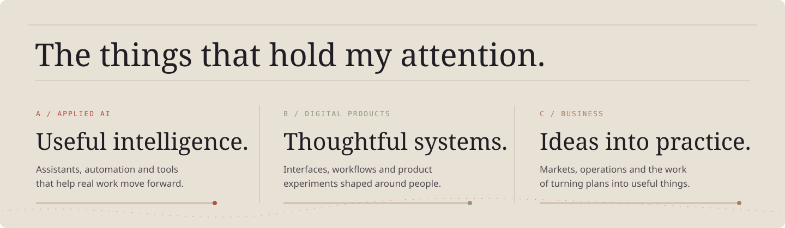
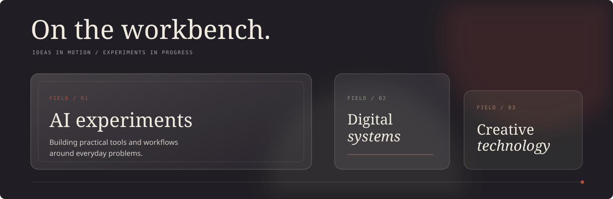
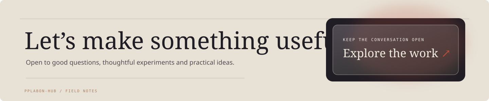

I’m a curious builder exploring the space between **AI, technology, business and creative design**. I enjoy turning ideas into practical systems, useful experiences and things people can actually use.

### How I approach the work

Start with the real problem. Ask better questions. Connect the dots. Make the result useful, then give it character.

### A little more about me

I’m interested in thoughtful tools, ambitious experiments and the human side of technology. I like visual storytelling, expressive typography and motion when they make an experience clearer or more memorable.

[Explore my repositories](https://github.com/pplabon-hub?tab=repositories) · [View my GitHub activity](https://github.com/pplabon-hub?tab=overview)

Curious by nature. Practical by design.

