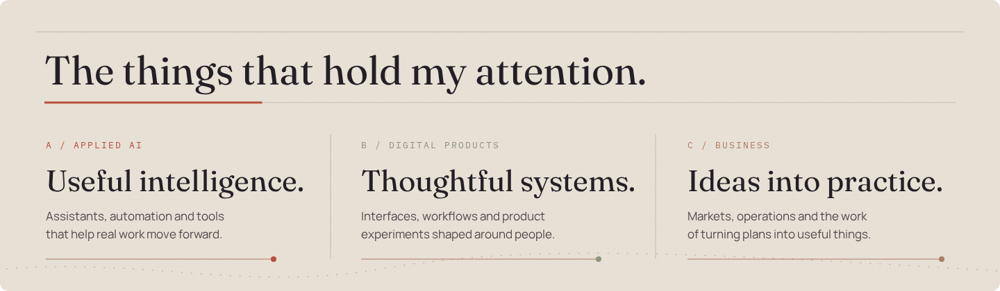
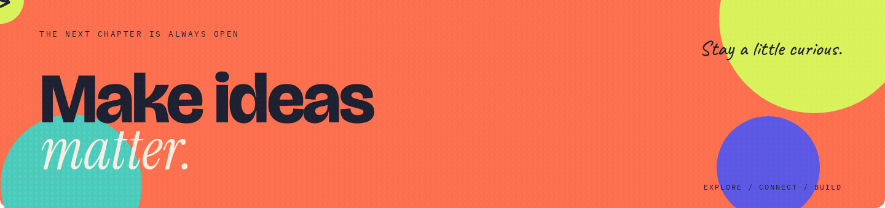

I’m a curious builder drawn to the overlap between **AI, technology, business and creative systems**. I like exploring how an idea can become something clear, useful and thoughtfully made.

### What I’m exploring

- **Applied AI**: practical assistants, useful automations and better ways to work.
- **Technology and products**: digital tools, interfaces and systems that solve real problems.
- **Business and growth**: experiments, operations and the path from an idea to something people can use.
- **Creative technology**: visual storytelling, motion and considered digital experiences.

### How I like to work

Start with the real problem. Stay curious about the details. Make the result useful before making it loud.

I share experiments, unfinished ideas and working projects as they evolve. This profile is a living notebook, not a list of claims or skill rankings.

[Explore my repositories](https://github.com/pplabon-hub?tab=repositories) · [View my GitHub activity](https://github.com/pplabon-hub?tab=overview)

Made with curiosity. Refined in public.

