I’m a traveller and a food lover. I like seeing how a place feels beyond its landmarks: the streets, the everyday details, the food, and the different ways people live.

### 01 / The places in my notebook

I’ve travelled to **the United States, South Korea, Malaysia, China, Thailand, India and Japan**. These pages are a collection, not a timeline. Each place adds another point of view.

### 02 / The table is part of the journey

Food is never just a stop between destinations. I’m curious about local flavours and the stories, rituals and people gathered around a table. A good meal can become part of how a place stays with you.

### 03 / What I bring back

The map records where I went. The margins hold what I noticed. Travel keeps widening my perspective and reminding me how much there is left to learn.

### 04 / Back at the desk

That same curiosity follows me home. I explore **AI, technology, business and creative ideas**, looking for useful ways to turn questions into things that work.

[Browse my projects and experiments](https://github.com/pplabon-hub?tab=repositories) · [See my GitHub activity](https://github.com/pplabon-hub?tab=overview)

KEEP THE PASSPORT. KEEP THE APPETITE. KEEP LOOKING CLOSER.

